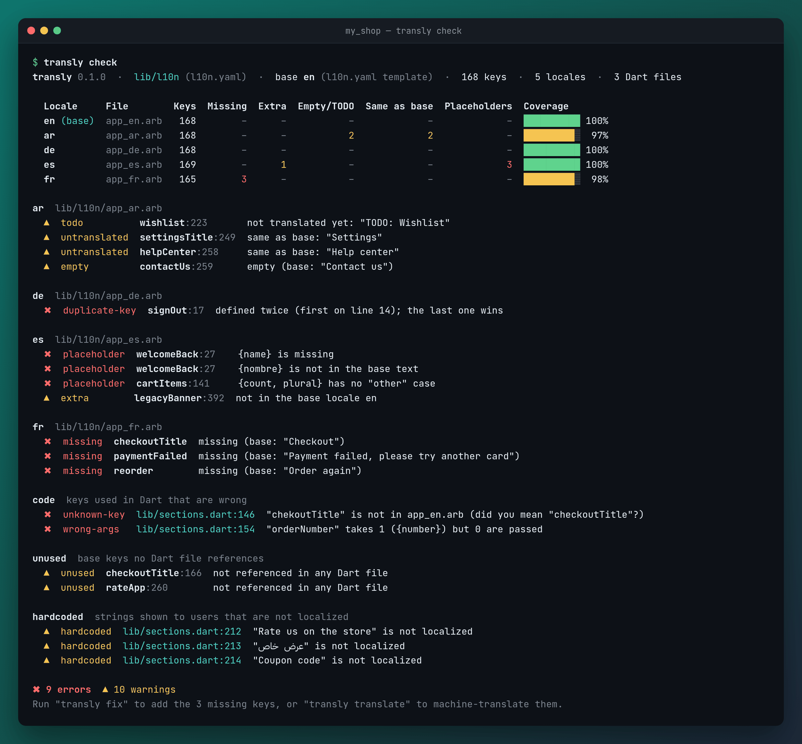
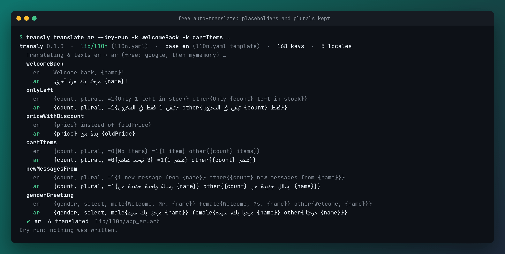

# transly

[](https://pub.dev/packages/transly)
[](LICENSE)

**Find and fix translation problems in Flutter apps, in one command.**

transly reads your `.arb` (Flutter gen-l10n) or `.json` (easy_localization) translation files **and your Dart code**, and tells you what is broken before your users see it: missing keys, broken `{placeholders}` and plurals, typos in key names, unused keys, strings you forgot to localize. Then it fixes what can be fixed, and can machine-translate the gaps **for free, with no API key**, without touching your placeholders.

Any language can be the base. Arabic → English works as well as English → Arabic.



## Why

A Flutter app with 5 languages and 200 keys drifts fast. Someone adds a key in English and forgets French. A translator writes `{nombre}` instead of `{name}` and the app shows a raw brace. Someone types `l10n.chekoutTitle`. A hardcoded `Text('Buy now')` slips into a PR. None of these fail until a user opens the wrong screen in the wrong language.

transly checks all of it in one pass and fails your CI when something is wrong.

## Features

- **Both formats**: `.arb` with `@key` metadata and `@@locale`, and flat or nested `.json` (`home.title`).
- **Finds your files by itself**: reads `arb-dir` and `template-arb-file` from `l10n.yaml`, else looks in `lib/l10n`, `assets/translations`, `assets/lang`, `assets/i18n`, `assets/l10n` and more, else `--dir`.
- **Every locale against the base**: missing keys, extra keys, empty and `TODO` values, text left identical to the base (short words, numbers and acronyms are skipped), duplicate keys and invalid JSON with the line number.
- **Placeholders and ICU**: `{name}` missing or renamed, a plural turned into plain text, a plural with no `other` case, positional `{}` counts, unbalanced braces. Different plural categories per language (Arabic `zero/two/few/many`) are fine.
- **Checks your Dart code**:
  - keys used in code that don't exist (`l10n.chekoutTitle`, `tr('auth.singIn')`), with a "did you mean"
  - wrong arguments: `l10n.orderNumber()` when the message needs `{number}`, `'home.greeting'.tr()` without `namedArgs: {'name': …}`, `args: [...]` vs `{}` count
  - unused keys
  - hardcoded user-facing strings in `Text(...)`, `hintText:`, `labelText:`, `tooltip:`, `title:` and friends, including Arabic text
- **Fixes without losing data**: `fix` adds the missing keys to every locale in the base order, keeps every existing value, indent and metadata, and refuses to touch a file it cannot parse. `--dry-run` shows a diff.
- **New language in one command**: `add fr` creates `app_fr.arb` with every key, in order, metadata included.
- **Free auto-translate**: `translate` fills missing, empty and TODO values. Placeholders are protected, plural and select cases are translated one by one and the ICU structure is rebuilt, so the output always compiles. Every machine translation is marked for review.
- **CI ready**: `--ci` exit codes, inline GitHub Actions annotations, `--json` output.
- Pure Dart with 3 small dependencies (`args`, `path`, `yaml`).

## Install

```bash
dart pub global activate transly
```

or as a dev dependency of your app:

```bash
dart pub add dev:transly        # or: flutter pub add dev:transly
dart run transly check
```

## Quick start

```bash
cd my_flutter_app
transly                 # same as: transly check
transly fix             # add missing keys everywhere ("TODO: <base text>")
transly translate       # machine-translate missing / TODO values, free
```

### Arabic base → add English

```bash
transly add en --base ar --translate     # creates en.json / app_en.arb, machine-translated
transly check --base ar                  # what is left to review
```

or without machine translation: `transly add en --base ar` writes every key with `"TODO: <Arabic text>"` (`--fill empty` or `--copy-base` for other values).

Save the base so you don't type it every time:

```bash
transly init --base ar     # writes transly.yaml
```

## Commands

| Command | What it does |
| --- | --- |
| `transly check` | Every locale against the base, plus the Dart code checks. The default command. `--no-code`, `--no-unused`, `--no-hardcoded`, `--no-identical`, `--ignore-key`, `--review`, `--fail-on error\|warning\|never` |
| `transly fix` | Add missing keys to every locale in base order, keep everything else. `--fill todo\|empty\|base`, `--remove-extra`, `--dry-run`, `-l <locale>` |
| `transly add <locale>` | Create a new locale file from the base. `--fill`, `--copy-base`, `--translate`, `--force`, `--dry-run` |
| `transly translate [<locale>...]` | Free machine translation of missing, empty and TODO values (all locales when none is given). `--overwrite`, `-k <key pattern>`, `--dry-run`, `--engine auto\|google\|mymemory` |
| `transly unused` | Base keys no Dart file references |
| `transly hardcoded` | User-facing strings that are not localized (works even before you have translations) |
| `transly init` | Write `transly.yaml` with what was detected |

Global options: `-C <project folder>`, `--dir`, `--base`, `--format arb|json`, `--json`, `--ci`, `--[no-]color`, `--all`.

Exit codes: `0` ok, `1` problems found with `--ci`, `64` bad usage, `65` a file could not be processed, `66` no translations found.

## Example output

`transly check` on a copy of the [example app](example) with some planted problems:

```text
transly 0.1.0  ·  lib/l10n (l10n.yaml)  ·  base en (l10n.yaml template)  ·  168 keys  ·  5 locales  ·  3 Dart files

  Locale     File        Keys  Missing  Extra  Empty/TODO  Same as base  Placeholders  Coverage
  en (base)  app_en.arb   168        –      –           –             –             –  ██████████ 100%
  ar         app_ar.arb   168        –      –           2             2             –  █████████░  97%
  de         app_de.arb   168        –      –           –             –             –  ██████████ 100%
  es         app_es.arb   169        –      1           –             –             3  ██████████ 100%
  fr         app_fr.arb   165        3      –           –             –             –  █████████░  98%

ar  lib/l10n/app_ar.arb
  ▲  todo          wishlist:223       not translated yet: "TODO: Wishlist"
  ▲  untranslated  settingsTitle:249  same as base: "Settings"
  ▲  untranslated  helpCenter:258     same as base: "Help center"
  ▲  empty         contactUs:259      empty (base: "Contact us")

de  lib/l10n/app_de.arb
  ✖  duplicate-key  signOut:17  defined twice (first on line 14); the last one wins

es  lib/l10n/app_es.arb
  ✖  placeholder  welcomeBack:27    {name} is missing
  ✖  placeholder  welcomeBack:27    {nombre} is not in the base text
  ✖  placeholder  cartItems:141     {count, plural} has no "other" case
  ▲  extra        legacyBanner:392  not in the base locale en

fr  lib/l10n/app_fr.arb
  ✖  missing  checkoutTitle  missing (base: "Checkout")
  ✖  missing  paymentFailed  missing (base: "Payment failed, please try another card")
  ✖  missing  reorder        missing (base: "Order again")

code  keys used in Dart that are wrong
  ✖  unknown-key  lib/sections.dart:146  "chekoutTitle" is not in app_en.arb (did you mean "checkoutTitle"?)
  ✖  wrong-args   lib/sections.dart:154  "orderNumber" takes 1 ({number}) but 0 are passed

unused  base keys no Dart file references
  ▲  unused  checkoutTitle:166  not referenced in any Dart file
  ▲  unused  rateApp:260        not referenced in any Dart file

hardcoded  strings shown to users that are not localized
  ▲  hardcoded  lib/sections.dart:212  "Rate us on the store" is not localized
  ▲  hardcoded  lib/sections.dart:213  "عرض خاص" is not localized
  ▲  hardcoded  lib/sections.dart:214  "Coupon code" is not localized

✖ 9 errors  ▲ 10 warnings
Run "transly fix" to add the 3 missing keys, or "transly translate" to machine-translate them.
```

## Free auto-translate

```text
$ transly translate ar --dry-run -k welcomeBack -k cartItems -k genderGreeting
transly 0.1.0  ·  lib/l10n (l10n.yaml)  ·  base en (l10n.yaml template)  ·  168 keys  ·  5 locales
  Translating 3 texts en → ar (free: google, then mymemory) …
  welcomeBack
    en    Welcome back, {name}!
    ar    مرحبًا بك مرة أخرى، {name}!
  cartItems
    en    {count, plural, =0{No items} =1{1 item} other{{count} items}}
    ar    {count, plural, =0{لا توجد عناصر} =1{1 عنصر} other{{count} عنصر}}
  genderGreeting
    en    {gender, select, male{Welcome, Mr. {name}} female{Welcome, Ms. {name}} other{Welcome, {name}}}
    ar    {gender, select, male{مرحبًا بك سيد {name}} female{مرحبًا بك، سيدة {name}} other{مرحبًا، {name}}}
  ✔ ar  3 translated  lib/l10n/app_ar.arb
Dry run: nothing was written.
```



How it works:

1. Placeholders (`{name}`, `{}`, `{price, number}`) become numbered tokens before anything is sent, and come back exactly once each, or the result is rejected.
2. Plural and select cases are sent one by one, and transly rebuilds `{count, plural, …}` around them. Keys, argument names and selectors are never sent.
3. Google Translate's public web endpoint is tried first, in batches, with retries and a pause between requests. Whatever fails goes to [MyMemory](https://mymemory.translated.net) (free; about 5,000 characters a day, 50,000 with `--email you@example.com`).
4. A value that still can't be translated keeps its `TODO`. Nothing is half-written.
5. Every machine translation is recorded in `.transly_review.json` (and gets `"x-translated": "auto"` in ARB metadata). `transly check` counts them in a **To review** column until a person edits the value. `transly check --review` lists them.

Free endpoints have no uptime promise and can rate-limit you. Machine translation is a first draft, so have a native speaker review it before you ship.

## Use it in CI (GitHub Actions)

```yaml
# .github/workflows/translations.yml
name: translations
on: [push, pull_request]
jobs:
  transly:
    runs-on: ubuntu-latest
    steps:
      - uses: actions/checkout@v4
      - uses: dart-lang/setup-dart@v1
      - run: dart pub global activate transly
      - run: transly check --ci            # fails on errors; add --fail-on warning to be strict
```

With `--ci` on GitHub Actions, every finding also shows up as an annotation on the right line of the pull request diff.

## Configuration

`transly.yaml` in the project root (all optional; command-line options win):

```yaml
dir: assets/translations      # default: l10n.yaml arb-dir, then common folders
base: ar                      # default: l10n.yaml template, then en, then the first file
format: auto                  # arb | json | auto
sources: [lib]                # Dart folders to scan
ignore_keys: [app_name, "debug_*"]          # skipped everywhere, wildcards allowed
ignore_untranslated: [brand, total]         # allowed to equal the base text
ignore_files: ["lib/dev/**"]                # Dart files not scanned
accessors: [t, context.loc]                 # extra names for your localizations object
```

Silence one line in Dart with `// transly:ignore` (same line or the line above), a whole file with `// transly:ignore-file`.

## How the code checks work (and their limits)

The Dart files are lexed (strings and comments handled properly) and matched with patterns, not compiled.

- **References** it understands: `AppLocalizations.of(context)!.key` (or your `output-class`), `context.l10n.key`, `l10n.key`, `S.of(context).key`, `S.current.key`, your `accessors`, and for JSON `'key'.tr()`, `tr('key')`, `context.tr('key')`, `'key'.plural(n)`, `plural('key', n)`.
- **Unused** is careful on purpose: a key counts as used if it appears as `.key`, as a `'key'` string, as `LocaleKeys.key` (easy_localization codegen), as the parent of a plural map, or as the start of an interpolated key like `'errors.$code'`. It may miss an unused key; it should not call a used key unused. Check before you delete.
- **Hardcoded** looks at the first argument of `Text`, `SelectableText`, `AutoSizeText` and named parameters like `title:`, `label:`, `hintText:`, `labelText:`, `helperText:`, `errorText:`, `tooltip:`, `message:`, `semanticLabel:`. Strings followed by `.tr()`, strings with no letters, asset paths and URLs are skipped.
- Generated files (`*.g.dart`, `*.freezed.dart`, gen-l10n output, `lib/generated/`) are skipped.

## How it compares

What the other packages say they do (from their pub.dev pages, November 2026):

- [intl_utils](https://pub.dev/packages/intl_utils) generates Dart code from ARB files. transly does not generate code: keep using `flutter gen-l10n`, intl_utils or easy_localization for that. transly checks what they read.
- [arb_utils](https://pub.dev/packages/arb_utils) has helpers to sort, merge and diff ARB files, and to switch the locale at runtime.
- [translations_cleaner](https://pub.dev/packages/translations_cleaner) removes unused keys from ARB files. transly reports unused keys (it never deletes them) and also handles JSON.
- [arb_translate](https://pub.dev/packages/arb_translate) fills missing ARB translations with Gemini or ChatGPT, using your API key. transly's `translate` is free and needs no key, also works on JSON, and checks the placeholders that come back.

transly puts all the checks in one command: every locale against the base, placeholders and ICU, your Dart code (unknown keys, wrong arguments, unused keys, hardcoded strings), safe fixes and CI output.

## Dart API

Everything the CLI does is also a library, see [example/example.dart](example/example.dart):

```dart
import 'package:transly/transly.dart';

final project = TranslyProject.load(root: '.');
final reports = checkFiles(project.base, project.targets);
for (final r in reports) {
  print('${r.locale}: ${(r.coverage * 100).round()}% translated, ${r.errors} errors');
}
```

## Contributing

Issues and pull requests are welcome at [github.com/AbdAlftahSalem/transly](https://github.com/AbdAlftahSalem/transly).

```bash
dart pub get
dart test                       # unit, CLI and integration tests
TRANSLY_LIVE=1 dart test        # also calls the free translation endpoints and runs Flutter end to end
```

## License

MIT © 2026 Abd Alftah Salem
